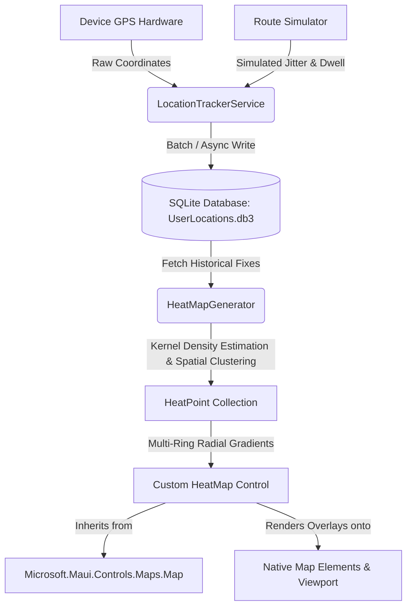

# LocationTracker

> **Final Software Development Project: Build Multiplatform "Location Tracker" App with .NET MAUI**

A cross-platform mobile and desktop application built with **C#** and **.NET MAUI** that records user GPS coordinates into a local **SQLite** database and renders position history as an interactive, real-time **Heat Map** by extending the **.NET MAUI Maps** component.

---

## 🌟 Key Features

1. **Extended .NET MAUI Maps Component (`HeatMap : Map`)**:
   - Subclasses `Microsoft.Maui.Controls.Maps.Map` to add native reactive data binding for heat telemetry.
   - Implements **Gaussian Kernel Density Estimation (KDE)** to cluster discrete coordinates into continuous density hotspots.
   - Generates multi-ring radial gradient vector overlays (`Circle` elements with alpha falloff and color ramps) that work seamlessly across **Android**, **iOS**, **Windows**, and **macOS (MacCatalyst)**.
   - Includes cross-platform MapHandler hooks (`HeatMapHandler`) for native map tile providers.

2. **Local SQLite Persistence**:
   - High-performance asynchronous database storage using `sqlite-net-pcl`.
   - Records latitude, longitude, altitude, accuracy, speed, heading, dwell time intensity, and timestamps.
   - Indexed spatial queries, date-range filtering, and batch insert capabilities.

3. **Background & Real-Time GPS Tracking**:
   - Uses `Microsoft.Maui.Devices.Sensors.Geolocation` with configurable sampling frequencies and accuracy levels.
   - Full permission lifecycle management for foreground and background location access.

4. **Built-in Movement & Dwell Simulator**:
   - Enables immediate testing on desktop machines and emulators without requiring you to walk outside.
   - Simulates authentic walking routes with directional heading, realistic GPS jitter, and dwell clusters (e.g. coffee shops, office, home).
   - "Seed Sample Data" button to instantly populate 150 realistic hotspot telemetry points.

5. **Interactive Heatmap Controls**:
   - Live calibration sliders for **Radius** (15m - 150m), **Global Opacity** (20% - 100%), and **Cluster Distance** (10m - 100m).
   - Real-time color palette switching between **Thermal Rainbow** and **Neon Glow**.
   - Floating telemetry HUD with live GPS indicators, coordinate chips, and zoom-to-fit framing.

---

## 🏗️ Architecture Overview



---

## 📁 Project Structure

```
LocationHeatMapApp/
├── LocationHeatMapApp.sln         # Visual Studio 2022 Solution
├── LocationHeatMapApp.csproj      # .NET MAUI Multi-targeted project
├── MauiProgram.cs                 # MAUI App builder, UseMauiMaps(), DI registration
├── AppShell.xaml                  # Navigation tabs (HeatMap, History, Settings)
│
├── Controls/
│   ├── HeatMap.cs                 # Extended .NET MAUI Map with bindable heat properties
│   ├── HeatMapHandler.cs          # MapHandler partial definition
│   └── HeatMapOverlayDrawable.cs  # 2D Hardware-accelerated canvas overlay
│
├── Models/
│   ├── LocationPoint.cs           # SQLite database entity
│   ├── HeatPoint.cs               # Clustered density node model
│   ├── HeatMapConfig.cs           # Heatmap radius, opacity, and clustering settings
│   └── HeatMapColorGradient.cs    # Thermal & Neon color interpolation ramps
│
├── Services/
│   ├── ILocationDatabase.cs       # Database repository contract
│   ├── LocationDatabase.cs       # Async SQLite implementation (sqlite-net-pcl)
│   ├── ILocationTracker.cs        # Geolocation tracking contract
│   ├── LocationTrackerService.cs  # Hardware GPS polling, simulator, sample generator
│   └── HeatMapGenerator.cs        # Haversine distance, KDE, and spatial clustering
│
├── ViewModels/
│   ├── BaseViewModel.cs
│   ├── MainMapViewModel.cs        # Primary ViewModel for map controls & telemetry
│   ├── HistoryViewModel.cs        # ViewModel for browsing and managing SQLite logs
│   └── SettingsViewModel.cs       # ViewModel for app parameters and storage stats
│
├── Views/
│   ├── MainMapView.xaml           # Heatmap UI with floating HUD and control drawer
│   ├── HistoryView.xaml           # Saved location points list and filters
│   └── SettingsView.xaml          # Telemetry and SQLite storage preferences
│
├── Platforms/
│   ├── Android/                   # AndroidManifest.xml, Google Maps metadata, handlers
│   ├── iOS/                       # Info.plist privacy descriptions, MapKit handlers
│   └── Windows/                   # Package.appxmanifest, WinUI App entry
│
└── tests/
    └── LocationHeatMapApp.Tests/  # xUnit tests for distance and clustering algorithms
```

---

## 🛠️ How It Works Under The Hood

### 1. Extending .NET MAUI Maps
The `HeatMap` class inherits directly from `Microsoft.Maui.Controls.Maps.Map`:

```csharp
public class HeatMap : Microsoft.Maui.Controls.Maps.Map
{
    public static readonly BindableProperty HeatPointsProperty = ...;
    public static readonly BindableProperty ConfigProperty = ...;

    public void RenderHeatMap()
    {
        MapElements.Clear();
        foreach (var point in HeatPoints)
        {
            // Renders concentric rings with Gaussian alpha falloff
            for (int ring = Config.ConcentricRingsCount; ring >= 1; ring--)
            {
                var circle = new Circle
                {
                    Center = new Location(point.Latitude, point.Longitude),
                    Radius = Distance.FromMeters(ringRadius),
                    FillColor = Config.Gradient.GetColorForIntensity(ringWeight, ringAlpha),
                    StrokeColor = Colors.Transparent
                };
                MapElements.Add(circle);
            }
        }
    }
}
```

### 2. Spatial Clustering and Density Estimation
Rather than blindly plotting thousands of overlapping pins which degrades frame rates, `HeatMapGenerator` processes raw points using a proximity grid:
- Points within `ClusterRadiusMeters` are merged into single density clusters.
- The weight is calculated based on sample count and dwell intensity.
- A non-linear gamma curve is applied to normalize the values between `0.0` and `1.0`.

---

## 🚀 Getting Started

### Prerequisites
- [.NET 8 SDK or .NET 9 SDK](https://dotnet.microsoft.com/download)
- Visual Studio 2022 (v17.8 or later) with the **.NET Multi-platform App UI development** workload installed.

### Opening and Running the Project
1. Open `LocationHeatMapApp.sln` in **Visual Studio 2022**.
2. Select your target framework and device:
   - **Windows Machine** (runs natively on Windows desktop).
   - **Android Emulator** or physical Android device.
   - **iOS Simulator** or physical iPhone (macOS paired or local).
3. Press **F5** or click **Run**.

### Google Maps API Key (Android only)
For Android deployment, Google Maps requires an API key:
1. Obtain an API key from the [Google Cloud Console](https://console.cloud.google.com/google/maps-apis).
2. Open `Platforms/Android/AndroidManifest.xml`.
3. Replace `YOUR_GOOGLE_MAPS_API_KEY_HERE` with your key:
```xml
<meta-data 
    android:name="com.google.android.geo.API_KEY" 
    android:value="AIzaSyYourActualKeyGoesHere" />
```

*(Note: iOS MapKit and Windows Maps do not require an API key for basic display).*

---

## 🧪 Running Unit Tests

Run the test suite using the .NET CLI:
```bash
dotnet test tests/LocationHeatMapApp.Tests/LocationHeatMapApp.Tests.csproj
```
Tests cover:
- Haversine distance accuracy.
- Multi-point spatial cluster grouping.
- Geographic bounding box calculation.
- Heat gradient color ramp interpolation.
